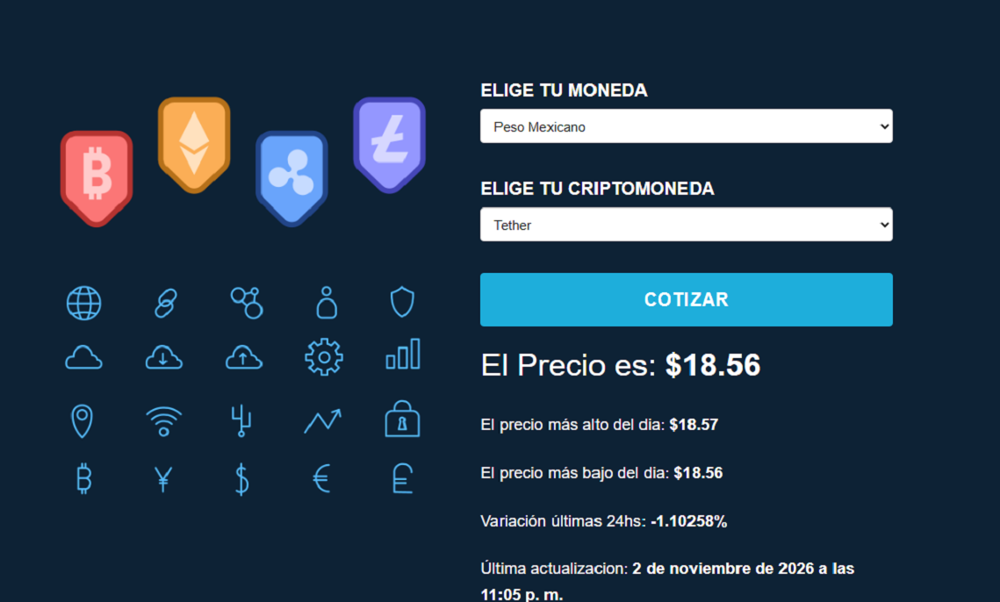
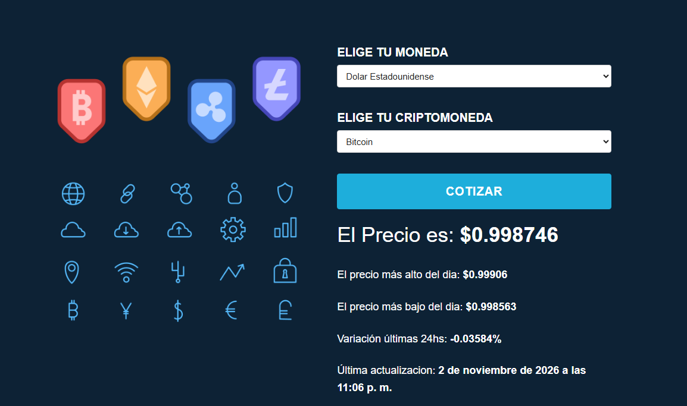
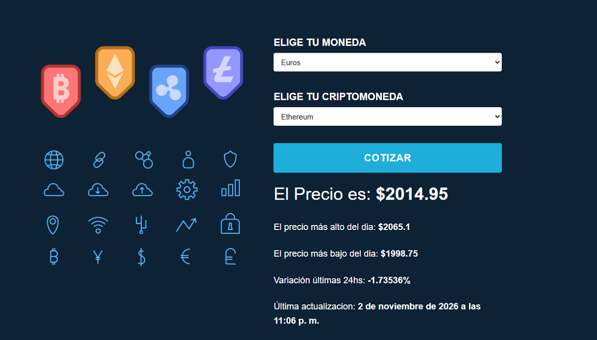

<div align="center">
  <h1>🪙 Cotizador de Criptomonedas</h1>
  <p>Aplicación web para consultar cotizaciones de criptomonedas en distintas monedas fiduciarias. Obtiene datos de mercado en tiempo real desde la API pública de <a href="https://www.coingecko.com/">CoinGecko</a>.</p>
  <p>
    
    
    
    
  </p>
</div>

---
## Demo

[AppCriptomonedas]( )

## 📸 Captura de pantalla

La siguiente captura muestra la selección de una moneda y una criptomoneda, junto con el resultado de una cotización:





## ✨ Funcionalidades

- 📈 Consulta las 10 criptomonedas con mayor capitalización de mercado disponibles en CoinGecko.
- 💱 Permite elegir entre USD, EUR, GBP, ARS, MXN, BRL y CLP.
- 🔄 Actualiza la lista de criptomonedas al cambiar la moneda de cotización.
- 💰 Muestra el precio actual, los valores máximo y mínimo de las últimas 24 horas, la variación porcentual y la fecha de actualización.
- ✅ Valida que se hayan seleccionado una moneda y una criptomoneda antes de cotizar.
- ⏳ Incluye un indicador visual de carga durante la consulta.
- 🕒 Presenta la fecha de actualización en español y en la zona horaria de Buenos Aires.

> Los precios y la disponibilidad de los datos dependen de CoinGecko y pueden variar según el momento de la consulta y los límites de la API.

## 🧰 Tecnologías

- HTML5
- CSS3
- JavaScript (sin frameworks ni proceso de compilación)
- [Skeleton](http://getskeleton.com/) y Normalize.css para estilos base
- API de mercados de [CoinGecko](https://docs.coingecko.com/reference/coins-markets)

## 📋 Requisitos

- Un navegador web moderno.
- Conexión a Internet para consultar CoinGecko.
- Una clave demo de CoinGecko, configurada en `js/apikey.js`.

## 🚀 Puesta en marcha

1. Clona el repositorio o descarga sus archivos.
2. Configura tu clave API en `js/apikey.js`:

   ```js
   const apikey = "TU_API_KEY_DEMO";
   ```

3. Sirve la carpeta del proyecto desde un servidor HTTP local. Por ejemplo, con Python:

   ```bash
   python -m http.server 8000
   ```

4. Abre `http://localhost:8000` en el navegador.
5. Selecciona la moneda de referencia y la criptomoneda, y pulsa **Cotizar**.

También puedes abrir `index.html` con una extensión de servidor local como Live Server. Usar HTTP local facilita las solicitudes a la API y evita restricciones que pueden aparecer al abrir el archivo directamente desde el sistema de archivos.

## 🔌 Uso de la API

La aplicación realiza solicitudes al endpoint de mercados de CoinGecko:

```text
GET https://api.coingecko.com/api/v3/coins/markets
```

Al cargar la página, solicita los primeros 10 activos ordenados por capitalización de mercado para la moneda seleccionada. Al enviar el formulario, consulta el activo elegido y muestra estos datos:

| Dato | Campo de CoinGecko |
| --- | --- |
| Precio actual | `current_price` |
| Máximo de 24 horas | `high_24h` |
| Mínimo de 24 horas | `low_24h` |
| Variación porcentual de 24 horas | `price_change_percentage_24h` |
| Última actualización | `last_updated` |

La moneda de referencia se envía en minúsculas a CoinGecko (por ejemplo, `USD` se convierte en `usd`).

## 📁 Estructura del proyecto

```text
.
├── index.html          # Estructura y formulario de la aplicación
├── css/
│   ├── app.css         # Estilos propios y animación de carga
│   ├── normalize.css   # Normalización de estilos entre navegadores
│   └── skeleton.css    # Cuadrícula y estilos base de Skeleton
├── img/
│   ├── cryptomonedas.png
│   └── cripto.PNG      # Captura incluida en este README
└── js/
    ├── app.js          # Carga de activos, validación y cotizaciones
    └── apikey.js       # Configuración de la clave de CoinGecko
```

## 🔐 Configuración y seguridad de la clave

`js/apikey.js` se carga en el navegador, por lo que cualquier clave colocada allí queda visible para quienes accedan a la aplicación. Esta configuración es adecuada únicamente para una demostración o un proyecto educativo con una clave demo y sus límites correspondientes. **No incluyas una clave privada o secreta en el código del cliente ni publiques credenciales personales.** Para un despliegue de producción, realiza las solicitudes desde un backend que proteja la clave y aplique controles de uso.

## ⚠️ Errores y límites

- La cotización requiere conexión a Internet y una respuesta válida de CoinGecko.
- La API puede responder con errores o límites de solicitudes; consulta la consola del navegador si no se cargan los activos o la cotización.
- La aplicación presenta los valores devueltos por la API sin ofrecer asesoramiento financiero ni garantizar la exactitud futura de los precios.

## 📄 Licencia

No se especifica una licencia en este proyecto. Consulta con el titular antes de reutilizar o distribuir el código.

---
- Para más información sobre el proyecto o servicios de desarrollo web: 

- <h2>**JEB$DEV**</h2>
- **Desarrollador FrontEnd - Javier Berchtold**

- [GitHub](https://github.com/JEB76-22)
- [LinkedIn](https://www.linkedin.com/in/javier-berchtold-4270a7182/)
- [Contacto](mailto:j.e.b.inter@gmail.com)
